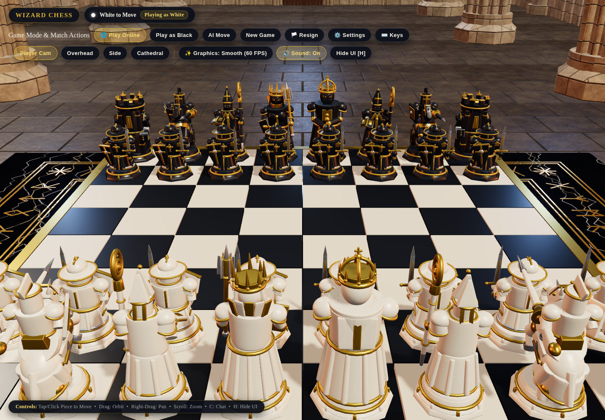

<div align="center">

# ♟️ Wizard Chess

### Enter the Sanctum. Challenge the AI. Claim the throne.

**A cinematic 3D chess experience set inside a gothic cathedral.**

[](https://react.dev/)
[](https://threejs.org/)
[](https://www.typescriptlang.org/)

</div>

## ✨ The Experience

- Sculpted 3D pieces and a richly detailed cathedral board
- Play solo against AI or challenge others online
- Cinematic captures, multiple camera angles, and in-game chat

<div align="center">



</div>

## 🚀 Run Locally

```bash
npm install
npm run dev
```

Open **http://localhost:3000** and begin your duel.
